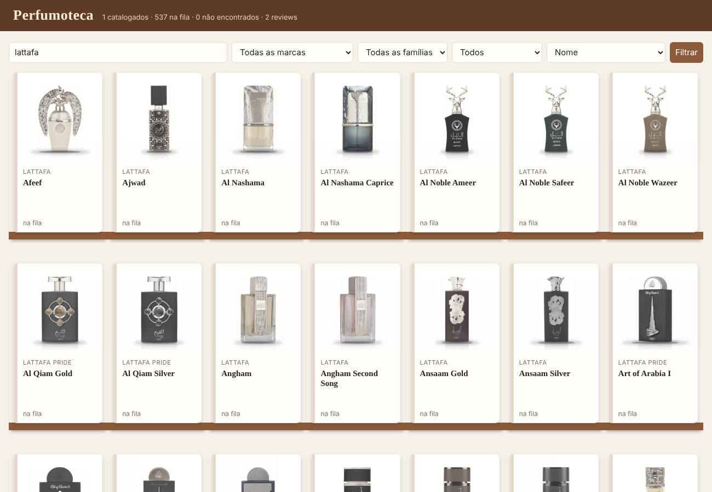
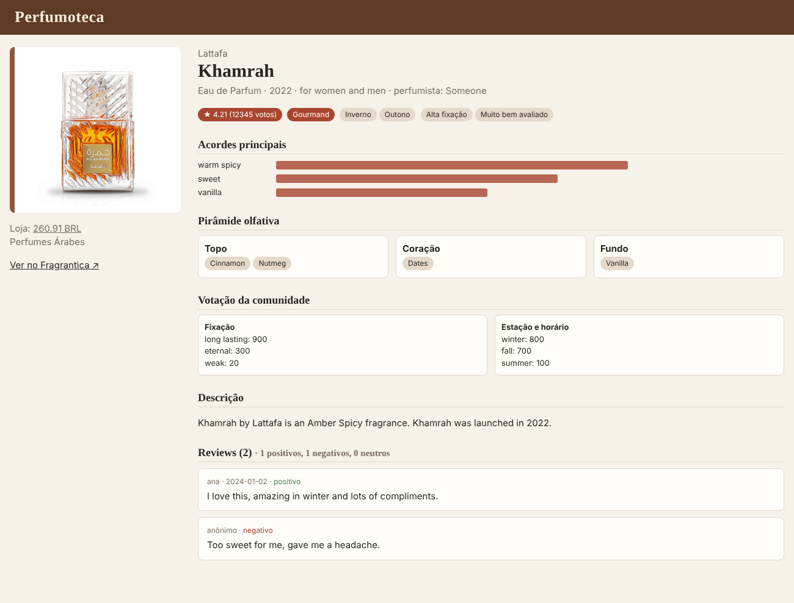
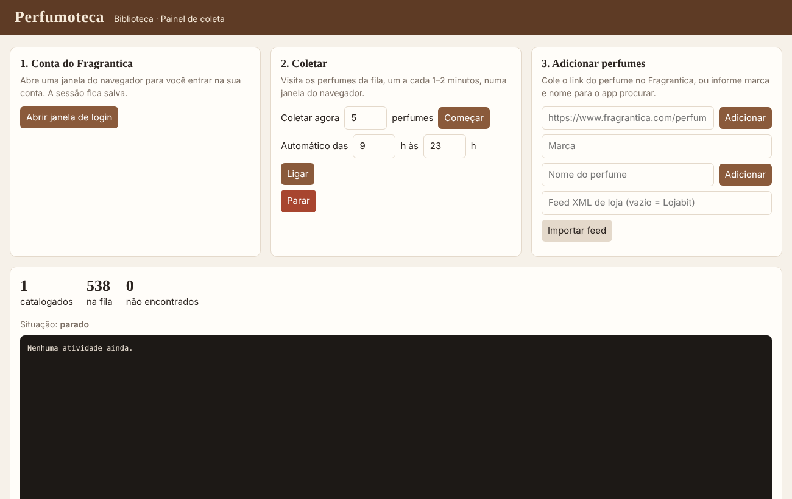

# Perfumoteca

Biblioteca pessoal de perfumes que roda no seu computador. O app:

1. lê a lista de perfumes de um feed de loja (ex.: o XML da Lojabit);
2. procura cada perfume no Fragrantica e guarda acordes, pirâmide olfativa, nota,
   votações (fixação, projeção, estação) e os reviews;
3. classifica cada um (família olfativa, estações, fixação alta, sentimento dos reviews);
4. mostra tudo numa interface no navegador, como uma estante de biblioteca.




## Como abrir

Precisa do [Python 3.10+](https://www.python.org/downloads/) (no Windows, marque "Add Python to PATH").

- **Windows:** dê duplo clique em `Perfumoteca.bat`.
- **Mac/Linux:** rode `./perfumoteca.sh`.

Na primeira vez ele instala tudo sozinho (leva alguns minutos). Depois o app abre no navegador,
no **Painel de coleta**, onde dá para fazer tudo por botões:

1. **Abrir janela de login**: abre o Fragrantica; entre na sua conta e clique em "Já entrei na minha conta".
2. **Importar feed**: monta a lista de perfumes da loja (≈540 perfumes únicos).
3. **Coletar agora** (comece com 3–5) ou **Ligar** o modo automático; **Parar** interrompe na hora.
4. **Adicionar perfumes**: cole o link do Fragrantica ou informe marca e nome.
5. **Biblioteca**: a estante com busca, filtros e a ficha de cada perfume.

Para o app continuar coletando, deixe a janela do terminal aberta.



### Pelo terminal (opcional)

```bash
python main.py importar | login | coletar --limite 5 | auto --inicio 9 --fim 23 | web
```

## Como a coleta se comporta

- Navegador de verdade, visível, com o **seu login salvo** em `dados/navegador/`.
- **1 a 2 minutos** (aleatório) entre perfumes; rola a página aos poucos, com pausas irregulares.
- No modo `auto`: rodadas de 8 a 15 perfumes, descanso de 20 a 60 minutos entre elas, e só no horário definido.
- Se aparecer verificação ("Just a moment…"/captcha), o coletor **pausa e espera você resolver** na janela.
  Se o site responder "muitas requisições" (429), ele **para** a rodada.
- Perfumes já coletados são revisitados a cada 30 dias (`--revisitar`) para buscar **reviews novos**,
  sem duplicar os antigos.
- Quando a busca não acha o perfume certo, ele fica como "não encontrado": abra a ficha na
  interface e cole o link correto do Fragrantica.

Uso pessoal: mantenha o ritmo baixo e não publique os textos dos reviews. Eles pertencem a quem escreveu.

## Onde ficam os dados

Tudo num único arquivo: `dados/perfumoteca.db` (SQLite).

- Fácil de fazer backup (é só copiar o arquivo).
- Dá para abrir e pesquisar com o [DB Browser for SQLite](https://sqlitebrowser.org/) ou exportar para CSV/Excel.
- Tem busca de texto completo (nome, marca, notas, acordes, família e reviews).
- Tabelas: `perfumes` (um por perfume, campos de listas em JSON) e `reviews` (um por review).

## Adicionar mais perfumes

Rode `python main.py importar <URL ou arquivo .xml>` com qualquer feed no formato Google Merchant.
Para outras fontes, basta inserir linhas na tabela `perfumes` com `status='pendente'`.

## Se o Fragrantica mudar o layout

Todos os seletores ficam em `perfumoteca/fragrantica.py`. Os testes (`python -m pytest tests`)
usam uma página de exemplo. Salve uma página real (Ctrl+S) para ajustar o parser se precisar.
